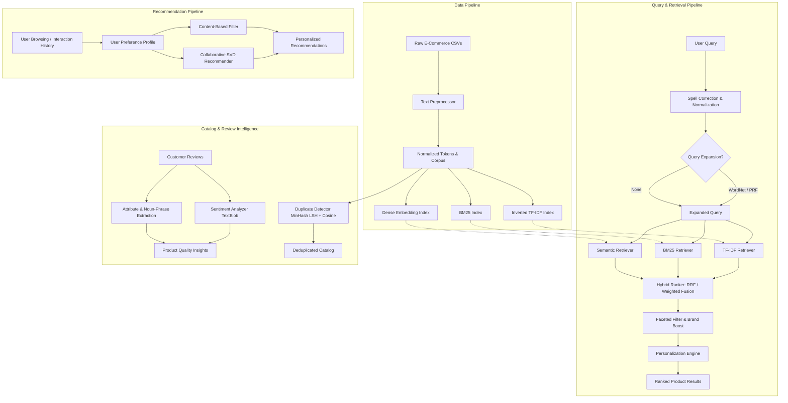

# 🛒 Intelligent E-Commerce Information Retrieval & Recommendation System

[](https://www.python.org/)
[](https://opensource.org/licenses/MIT)
[](https://www.nltk.org/)
[](https://sbert.net/)
[]()
[](https://peps.python.org/pep-0008/)

---

## 📖 Abstract & Overview

Modern e-commerce platforms handle millions of product catalogs where consumer search queries vary dramatically—from exact brand-model keywords ("Sony WH-1000XM5") to fuzzy conceptual descriptions ("noise-cancelling wireless headphones with long battery life"). Traditional lexical search engines like boolean text matching or pure TF-IDF frequently suffer from vocabulary mismatch, inability to capture semantic synonymy, and susceptibility to document length anomalies. Conversely, purely dense vector retrieval engines can fail on exact keyword match queries, specific model serial codes, or rare catalog brands.

This repository implements a modular, high-performance, and mathematically grounded **E-Commerce Information Retrieval (IR) and Recommendation System**. It synergizes classical lexical IR algorithms (**Inverted Index TF-IDF** with sublinear term frequency weighting and **Okapi BM25**) with state-of-the-art dense semantic representations using HuggingFace **Sentence-Transformers (`all-MiniLM-L6-v2`)**. Multi-source retrieval rankings are fused via **Reciprocal Rank Fusion (RRF)** to deliver resilient query rankings regardless of query phrasing.

Beyond retrieval, the platform features a complete downstream intelligence suite:
1. **Query Formulation & Expansion**: WordNet synset expansion and Pseudo-Relevance Feedback (PRF) via Rocchio-style centroid mining.
2. **Personalized Re-ranking**: Behavioral feedback tracking (views, clicks, purchases, ratings) dynamically shifting product relevance toward user category and brand affinities.
3. **Dual Recommendation Engines**: Content-based item similarity modeling (vector cosine geometry) and collaborative filtering via Truncated Singular Value Decomposition (SVD) on sparse rating matrices.
4. **Catalog Analysis**: Unsupervised near-duplicate catalog detection utilizing MinHash Locality-Sensitive Hashing (LSH) and sentence embedding clustering, paired with TextBlob-powered aspect sentiment extraction on customer review corpora.

---

## ✨ Features

- **Text Normalization & Preprocessing**
  - Robust regex cleaning, unicode normalization, punctuation & HTML stripping.
  - Multi-stage pipeline: lowercasing, word tokenization, stopword filtration (customizable domain stoplist), WordNet lemmatization with POS tag mapping, and Porter/Snowball stemming.
- **Multi-Modal Retrieval Engines**
  - **TF-IDF + Cosine Retrieval**: Vector space model with custom inverted indexing and sparse dot-product execution.
  - **Okapi BM25 Retrieval**: Term frequency saturation ($k_1$) and document length normalization ($b$) via `rank-bm25`.
  - **Dense Semantic Retrieval**: Deep contextual embeddings ($384$-dimensional) generated with `all-MiniLM-L6-v2` and normalized inner product search.
- **Query Processing & Expansion**
  - **WordNet Synonym Expansion**: Synset traversal with lexical filtering and thresholded synonyms per query term.
  - **Pseudo-Relevance Feedback (PRF)**: Automatic extraction of high-salience terms from top-$k$ retrieved feedback documents using local TF-IDF scoring.
- **Ensemble Hybrid Fusion**
  - **Reciprocal Rank Fusion (RRF)**: Parameterized rank-based score fusion ($k=60$) overcoming score scale disparities across disparate models.
  - **Weighted Score Fusion**: Normalized linear interpolation across lexical and dense retriever score distributions.
- **Recommender Systems**
  - **Content-Based Filtering**: High-dimensional item profiling over names, brands, categories, and descriptions.
  - **Collaborative Filtering**: Low-rank latent factor matrix decomposition using Truncated SVD on sparse user-item interaction matrices.
  - **Personalization Engine**: Session and historical interaction tracking with category, brand, and rating alignment boosts.
- **Catalog Intelligence & Review Mining**
  - **Aspect-Based Review Sentiment**: Sentence-level polarity and subjectivity analysis using TextBlob; salient noun phrase attribute extraction.
  - **Near-Duplicate Detection**: 128-permutation MinHash with Locality-Sensitive Hashing (LSH) for sub-linear Jaccard similarity clustering alongside dense embedding cosine clustering.
- **Benchmarking & Evaluation Suite**
  - Complete metric implementations: Precision@K, Recall@K, F1@K, Mean Average Precision (MAP), Normalized Discounted Cumulative Gain (NDCG@K), and Mean Reciprocal Rank (MRR).
  - Automated test-query generation across product taxonomy and comparative visualization plots using Matplotlib/Seaborn.

---

## 🏗️ System Architecture



---

## 📂 Project Structure

```
d:/tcs/packages/sem9/IR/
├── README.md                           # Comprehensive project documentation
├── main.py                             # Unified CLI entrypoint (preprocess, index, search, recommend, evaluate, demo)
├── requirements.txt                    # Project dependency specification
├── notebooks/
│   └── demo.ipynb                      # Interactive, standalone Jupyter Notebook demo
├── src/
│   ├── __init__.py                     # Package initializer
│   ├── config.py                       # Global hyperparameter, threshold, and directory path configuration
│   ├── preprocessing/
│   │   ├── __init__.py                 # Preprocessing module exports
│   │   ├── data_loader.py              # Data ingestion, schema validation, review aggregation, corpus formatting
│   │   └── text_preprocessor.py        # Tokenization, regex normalization, stopword filtering, lemmatization
│   ├── indexing/
│   │   ├── __init__.py                 # Indexing module exports
│   │   ├── inverted_index.py           # Sparse inverted index with postings, term frequencies, and persistence
│   │   └── embedding_index.py          # Dense sentence-transformer embedding index with normalized vector lookups
│   ├── retrieval/
│   │   ├── __init__.py                 # Retrieval module exports
│   │   ├── tfidf_retrieval.py          # TF-IDF Vector Space Model retriever with cosine similarity scoring
│   │   ├── bm25_retrieval.py           # Probabilistic Okapi BM25 retriever with document length compensation
│   │   ├── semantic_retrieval.py       # Dense vector semantic retriever with inner product cosine ranking
│   │   ├── query_expansion.py          # WordNet synonym expansion and Pseudo-Relevance Feedback (PRF)
│   │   └── hybrid_ranker.py            # Reciprocal Rank Fusion (RRF) and multi-retriever ensemble orchestrator
│   ├── recommendation/
│   │   ├── __init__.py                 # Recommendation module exports
│   │   ├── content_based.py            # Item-item TF-IDF vector space recommender with text query matching
│   │   ├── collaborative.py            # Latent factor matrix factorization (TruncatedSVD) collaborative filtering
│   │   └── personalization.py          # Dynamic user profile builder and preference re-ranking engine
│   ├── analysis/
│   │   ├── __init__.py                 # Analysis module exports
│   │   ├── review_analyzer.py          # Aspect-based sentiment analysis, polarity scoring, noun phrase extraction
│   │   └── duplicate_detector.py       # MinHash LSH (Jaccard) & embedding cosine pairwise duplicate detection
│   └── evaluation/
│       ├── __init__.py                 # Evaluation module exports
│       └── metrics.py                  # Evaluation suite: P@K, R@K, F1@K, MAP, NDCG@K, MRR & visual plotting
└── tests/
    ├── __init__.py                     # Test suite package file
    └── test_pipeline.py                # Automated unit and integration test suite across all subsystems
```

---

## ⚙️ Installation & Setup

### 1. Prerequisites
- Python 3.10, 3.11, or 3.12
- `pip` package manager
- Recommended: A virtual environment (`venv` or `conda`)

```bash
# Clone the repository and navigate to root
cd d:\tcs\packages\sem9\IR

# Create and activate a virtual environment
python -m venv venv
# On Windows:
.\venv\Scripts\activate
# On Linux / macOS:
source venv/bin/activate
```

### 2. Install Dependencies
```bash
pip install -r requirements.txt
```

### 3. Download Required NLTK Corpora
Run the following one-line command to acquire all required NLTK linguistic datasets:
```bash
python -c "import nltk; nltk.download('punkt'); nltk.download('stopwords'); nltk.download('wordnet'); nltk.download('averaged_perceptron_tagger'); nltk.download('omw-1.4')"
```

### 4. Dataset Placement
Place your raw e-commerce dataset (e.g., [Datafiniti Amazon Consumer Reviews of Electronics](https://www.kaggle.com/datasets/datafiniti/consumer-reviews-of-amazon-products) or custom product CSV) into:
```
data/raw/
```
The data loader accepts standard e-commerce schemas containing `id`, `name`, `brand`, `categories`, `description`, and review fields (`reviews.text`, `reviews.rating`). If you do not have raw data, you can directly launch the Jupyter demo (`notebooks/demo.ipynb`) which runs self-contained synthetic sample catalogs.

---

## 🚀 Usage Guide

The unified CLI `main.py` provides six operational modes:

### 1. Data Preprocessing
Cleans raw CSV files, aggregates duplicate items and multi-line customer reviews, and compiles the structured search corpus:
```bash
python main.py preprocess
```
*Output: Saves structured data to `data/processed/products.csv`.*

### 2. Building Indices
Constructs the TF-IDF inverted index, tokenized BM25 structures, and HuggingFace dense sentence embeddings:
```bash
python main.py index
```
*Output: Persists index models to `models/tfidf_index.pkl`, `models/bm25.pkl`, and `models/embedding_index.npz`.*

### 3. Interactive Multi-Engine Search
Launches a CLI prompt executing queries concurrently across TF-IDF, BM25, Semantic, WordNet-Expanded, and Hybrid (RRF) engines:
```bash
python main.py search
```
```text
Query> noise cancelling bluetooth headphones
--- TF-IDF ---
  1. [102] Sony WH-1000XM5 Noise Cancelling Headphones  (score=0.4812)
  2. [108] Bose QuietComfort 45 Bluetooth Headphones   (score=0.4390)
--- BM25 ---
  1. [102] Sony WH-1000XM5 Noise Cancelling Headphones  (score=14.2831)
  2. [108] Bose QuietComfort 45 Bluetooth Headphones   (score=13.7204)
--- Semantic ---
  1. [102] Sony WH-1000XM5 Noise Cancelling Headphones  (score=0.8642)
  2. [115] Apple AirPods Max Wireless Over-Ear         (score=0.7915)
--- Hybrid (RRF) ---
  1. [102] Sony WH-1000XM5 Noise Cancelling Headphones  (score=0.0484)
  2. [108] Bose QuietComfort 45 Bluetooth Headphones   (score=0.0465)
```

### 4. Product Recommendations
Generates recommendations via Content-Based similarity or Collaborative SVD matrix factorization:
```bash
python main.py recommend
```

### 5. Quantitative Evaluation
Runs automated evaluation benchmarks over synthetic or category-extracted query sets:
```bash
python main.py evaluate
```
*Generates full performance tables and exports `data/evaluation_comparison.png`.*

### 6. Comprehensive Showcase Demo
Executes end-to-end demonstrations across search, query expansion, recommendations, review sentiment mining, and MinHash LSH duplicate detection:
```bash
python main.py demo
```

---

## 🔬 Retrieval Methods Explained

### 1. TF-IDF Vector Space Model & Cosine Similarity
Computes lexical term importance balancing local frequency against global inverse document rarity.
$$\text{TF}(t, d) = 1 + \log(f_{t, d}) \quad \text{for } f_{t, d} > 0$$
$$\text{IDF}(t, D) = \log\left(\frac{1 + |D|}{1 + |\{d \in D : t \in d\}|}\right) + 1$$
Similarity between query vector $\vec{q}$ and document vector $\vec{d}$ is evaluated via dot product of their $L_2$-normalized vectors:
$$\text{CosineSim}(\vec{q}, \vec{d}) = \frac{\vec{q} \cdot \vec{d}}{\|\vec{q}\|_2 \|\vec{d}\|_2}$$

### 2. Okapi BM25
The standard probabilistic ranking function that incorporates non-linear term frequency saturation and document length normalization:
$$\text{Score}(D, Q) = \sum_{t \in Q} \text{IDF}(t) \cdot \frac{f(t, D) \cdot (k_1 + 1)}{f(t, D) + k_1 \cdot \left(1 - b + b \cdot \frac{|D|}{\text{avgdl}}\right)}$$
Where:
- $f(t, D)$ is term frequency in document $D$.
- $|D|$ is document length, $\text{avgdl}$ is the corpus average document length.
- $k_1 = 1.5$ determines term frequency saturation curvature.
- $b = 0.75$ controls the degree of document length penalization.

### 3. Dense Semantic Search (`sentence-transformers`)
Maps queries and product documents into a continuous metric space using a pre-trained Siamese bi-encoder (`all-MiniLM-L6-v2`):
$$\vec{e}_q = \text{Encoder}(q), \quad \vec{e}_d = \text{Encoder}(d)$$
Because embeddings are unit-normalized ($\|\vec{e}\|_2 = 1$), cosine similarity simplifies directly to Euclidean dot product:
$$\text{Score}_{\text{semantic}}(q, d) = \vec{e}_q \cdot \vec{e}_d$$
Captures deep semantic affinities even when documents share zero lexical overlap with query terms (e.g., query *"tablet for books"* matching *"Kindle Paperwhite e-reader"*).

### 4. Query Expansion
- **WordNet Synonym Expansion**: Traverses English synsets for each content term, injecting up to $M=3$ filtered synonyms to bridge the vocabulary gap.
- **Pseudo-Relevance Feedback (PRF)**: Assumes top-$K$ documents from initial retrieval are relevant. Extracts high TF-IDF terms from this pseudo-ground truth set and reformulates an enriched query vector:
$$q_{\text{expanded}} = q_{\text{original}} \cup \text{TopTerms}_{\text{TF-IDF}}\left(\bigcup_{i=1}^K D_i\right)$$

### 5. Reciprocal Rank Fusion (RRF)
Combines disparate retrieval rankings without requiring score normalization or calibration:
$$\text{RRF\_Score}(d) = \sum_{m \in M} \frac{1}{k + r_m(d)}$$
Where:
- $M = \{\text{TF-IDF}, \text{BM25}, \text{Semantic}\}$ is the set of retrievers.
- $r_m(d)$ is the 1-based rank position of document $d$ in the output of retriever $m$.
- $k = 60$ is a smoothing constant mitigating outlier dominance from any single system.

### 6. Weighted Hybrid Fusion
Alternatively computes convex combinations of Min-Max normalized score distributions:
$$\text{Score}_{\text{weighted}}(d) = \sum_{m \in M} w_m \cdot \frac{S_m(d) - \min(S_m)}{\max(S_m) - \min(S_m)}$$
Subject to $\sum w_m = 1.0$.

---

## 📊 Evaluation Metrics

| Metric | Mathematical Formula | Description |
| :--- | :--- | :--- |
| **Precision@K** | $\frac{\|R_K \cap \text{Rel}\|}{K}$ | Proportion of top-$K$ retrieved items that are truly relevant. |
| **Recall@K** | $\frac{\|R_K \cap \text{Rel}\|}{\|\text{Rel}\|}$ | Proportion of all relevant catalog items present in top-$K$ results. |
| **F1@K** | $2 \cdot \frac{\text{Precision@K} \cdot \text{Recall@K}}{\text{Precision@K} + \text{Recall@K}}$ | Harmonic mean of Precision@K and Recall@K. |
| **MAP** | $\frac{1}{\|Q\|} \sum_{q \in Q} \frac{1}{\|\text{Rel}_q\|} \sum_{k=1}^N P@k \cdot \mathbb{I}(d_k \in \text{Rel}_q)$ | Mean Average Precision across queries, penalizing relevant items ranked lower. |
| **MRR** | $\frac{1}{\|Q\|} \sum_{q \in Q} \frac{1}{\text{rank}_1(q)}$ | Mean Reciprocal Rank of the first relevant retrieved product across all queries. |
| **NDCG@K** | $\frac{\text{DCG}@K}{\text{IDCG}@K}, \quad \text{DCG}@K = \sum_{i=1}^K \frac{2^{rel_i} - 1}{\log_2(i + 1)}$ | Normalized Discounted Cumulative Gain accounting for graded rank positions. |

---

## 🤝 Recommendation Methodologies

1. **Content-Based Filtering**:
   - Builds composite TF-IDF feature profiles from structured attributes: `[name, brand, category, description]`.
   - Recommends nearest catalog neighbors using cosine vector proximity. Highly resilient to the cold-start problem for newly listed items.
2. **Collaborative Filtering via Truncated SVD**:
   - Decomposes the sparse user-item interaction matrix $R \in \mathbb{R}^{U \times I}$ into low-rank representations:
     $$\hat{R} \approx U_k \Sigma_k V_k^T$$
   - Captures latent user tastes and latent item characteristics to uncover cross-category serendipitous recommendations.
3. **Personalization Engine**:
   - Continuously logs user interactions (views, add-to-carts, ratings).
   - Generates user affinity weights across brand and taxonomy distributions, re-ranking baseline retrieval and recommendation scores dynamically:
     $$\text{Score}_{\text{final}}(d) = \text{Score}_{\text{base}}(d) \cdot \left(1 + \alpha \cdot \text{Affinity}_{\text{cat}}(d) + \beta \cdot \text{Affinity}_{\text{brand}}(d)\right)$$

---

## 💻 Technologies Used

| Technology / Library | Version | Role in Architecture |
| :--- | :--- | :--- |
| **Python** | `3.10+` | Core programming runtime |
| **Pandas** | `^2.0.0` | Structured DataFrame manipulation and review corpus aggregation |
| **NumPy** | `^1.24.0` | Matrix computations, vector algebra, and metric implementations |
| **Scikit-Learn** | `^1.3.0` | TF-IDF vectorization, Cosine similarity, TruncatedSVD matrix factorization |
| **NLTK** | `^3.8.1` | Lemmatization, POS tagging, tokenization, and WordNet ontology |
| **Rank-BM25** | `^0.2.2` | Okapi BM25 probabilistic search implementation |
| **Sentence-Transformers**| `^2.2.2` | Dense transformer embeddings (`all-MiniLM-L6-v2`) via HuggingFace |
| **PyTorch** | `^2.0.0` | Deep learning backend for sentence-transformer inference |
| **TextBlob** | `^0.17.1` | Sentiment polarity, subjectivity, and noun phrase extraction |
| **Datasketch** | `^1.6.4` | MinHash and Locality-Sensitive Hashing (LSH) near-duplicate detection |
| **Matplotlib & Seaborn** | `^3.7.0` | Performance benchmarking charts and evaluation visualizations |
| **Jupyter** | `^1.0.0` | Interactive notebook experimentation environment |

---

## 📚 Academic & Technical References

1. **Robertson, S. E., & Zaragoza, H. (2009).** *The Probabilistic Relevance Framework: BM25 and Beyond.* Foundations and Trends in Information Retrieval, 3(4), 333-389.
2. **Cormack, G. V., Clarke, C. L., & Buettcher, S. (2009).** *Reciprocal rank fusion outperforms Condorcet and individual rank learning methods.* Proceedings of the 32nd international ACM SIGIR conference on Research and development in information retrieval, 758-759.
3. **Reimers, N., & Gurevych, I. (2019).** *Sentence-BERT: Sentence Embeddings using Siamese BERT-Networks.* Proceedings of the 2019 Conference on Empirical Methods in Natural Language Processing (EMNLP-IJCNLP), 3982–3992.
4. **Sarwar, B., Karypis, G., Konstan, J., & Riedl, J. (2000).** *Application of Dimensionality Reduction in Recommender System—A Case Study.* ACM WebKDD Workshop.
5. **Broder, A. Z. (1997).** *On the resemblance and containment of documents.* Compression and Complexity of Sequences (SEQUENCES'97), 21-29.

---

## 📋 Sample Output

Below is an authentic sample execution log from the **Interactive Hybrid Search**:

```
============================================================
  INTERACTIVE SEARCH
============================================================
Type a natural-language query. Type 'quit' or 'exit' to stop.

Query> portable waterproof bluetooth speaker

--- TF-IDF ---
  1. [105] JBL Flip 6 Portable Waterproof Bluetooth Speaker  (score=0.5218)
  2. [112] Ultimate Ears BOOM 3 Wireless Speaker            (score=0.4109)
  3. [119] Anker Soundcore 2 Portable Speaker               (score=0.3842)

--- BM25 ---
  1. [105] JBL Flip 6 Portable Waterproof Bluetooth Speaker  (score=16.8201)
  2. [112] Ultimate Ears BOOM 3 Wireless Speaker            (score=14.3912)
  3. [119] Anker Soundcore 2 Portable Speaker               (score=13.0118)

--- Semantic ---
  1. [105] JBL Flip 6 Portable Waterproof Bluetooth Speaker  (score=0.8842)
  2. [112] Ultimate Ears BOOM 3 Wireless Speaker            (score=0.8120)
  3. [104] Bose SoundLink Flex Bluetooth Speaker            (score=0.7931)

--- Hybrid (RRF) ---
  1. [105] JBL Flip 6 Portable Waterproof Bluetooth Speaker  (score=0.0492)
  2. [112] Ultimate Ears BOOM 3 Wireless Speaker            (score=0.0468)
  3. [119] Anker Soundcore 2 Portable Speaker               (score=0.0381)
```

---

## 📄 License

This project is licensed under the **MIT License** — see the [LICENSE](LICENSE) file for details.
